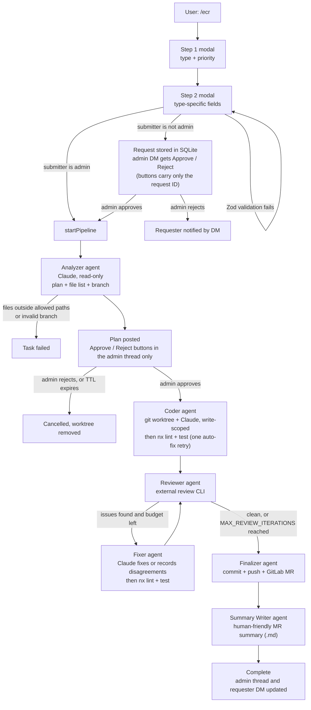

# ECR Dev Factory (AI-REPO-agent)

A Slack bot that takes a development request (bug fix, feature, refactor or documentation), turns it into a plan, writes the code with the Claude CLI, reviews and fixes it, then opens a GitLab merge request. It targets one service (plus optional related paths) inside an Nx/NestJS monorepo.

People ask for work with `/ecr` in Slack. A single **admin** approves each request, then approves the generated plan. Everything after plan approval runs on its own: code, `nx lint` and `nx test`, external review, fixes, commit, push, MR, and summary documents.

## Contents

- [How it works](#how-it-works)
- [Requirements](#requirements)
- [Slack app setup](#slack-app-setup)
- [Configuration](#configuration)
- [Running locally](#running-locally)
- [Running tests](#running-tests)
- [Security model](#security-model)
- [Operations and recovery](#operations-and-recovery)
- [Limitations](#limitations)
- [Project layout](#project-layout)

## How it works



- **Coordinator** (`src/pipeline/coordinator.ts`) is the only part that talks to Slack. It moves tasks between phases and decides which agent runs next.
- **Agents** (`src/agents/*`) never touch Slack. They read and write task state in SQLite and return typed results.
- **State** lives only in SQLite (`DB_PATH`), so a task survives a restart. If the process dies while a task is running, that task is marked `failed` on the next start, and the admin can continue it with `/ecr-resume`.
- **Progress** goes to a thread in the admin's DM. When someone other than the admin made the request, the same updates are copied to a thread in the requester's DM, except the approval buttons.
- **Documents** are uploaded to the threads as `.md` files: the execution plan, review feedback for each iteration, review disagreements, the execution summary, and the MR summary.
- **Chat**: DM the bot or @mention it to ask questions about the service. Claude answers in read-only mode.

### Phases

`analyzing` → `awaiting_plan_approval` → `executing` → `reviewing` ⇄ `fixing` → `creating_mr` → `complete`. A task can also end as `failed` or `cancelled`.

## Requirements

On the machine that runs the bot:

| Tool | Used for |
|------|----------|
| Node.js **22+** | the bot itself |
| `git` | worktrees, commit, push. Credentials for pushing to the remote must already work non-interactively. |
| [`claude`](https://docs.anthropic.com/en/docs/claude-code) CLI | analysis, coding, fixing, summaries, chat. It must already be authenticated. |
| `npx nx` in the monorepo | `nx lint <MY_SERVICE>` and `nx test <MY_SERVICE>` |
| `review` CLI | external code review (`review --ci --source local --title … --problem … --solution … --fresh`). It must print the path of the `.md` report it writes. |
| `glab` (optional) | creates the MR. If `glab` fails, the bot falls back to the GitLab REST API. |

You also need a local clone of the monorepo at `MONOREPO_ROOT`, with `node_modules` installed. Each worktree symlinks it.

## Slack app setup

1. Create an app at <https://api.slack.com/apps> ("From scratch").
2. **Socket Mode**: turn it on. Create an app-level token with the `connections:write` scope. This is `SLACK_APP_TOKEN` (`xapp-…`). Socket Mode needs no public URL.
3. **OAuth & Permissions → Bot Token Scopes**:

   | Scope | Why |
   |-------|-----|
   | `commands` | `/ecr` and `/ecr-resume` |
   | `chat:write` | thread messages and ephemeral notices |
   | `im:write` | open DMs with the admin and requesters (`conversations.open`) |
   | `im:history` | receive DM messages for chat mode |
   | `app_mentions:read` | answer @mentions |
   | `files:write` | upload `.md` documents (`files.uploadV2`) |
   | `users:read` | reviewer display names |
   | `users:read.email` | map MR reviewers from Slack to GitLab by email |

   Install the app to the workspace. The **Bot User OAuth Token** is `SLACK_BOT_TOKEN` (`xoxb-…`). The **Signing Secret** (under Basic Information) is `SLACK_SIGNING_SECRET`.
4. **Slash Commands**: create `/ecr` (submit a request) and `/ecr-resume` (admin only: list or resume tasks). In Socket Mode the Request URL is not used, so any placeholder will do.
5. **Interactivity & Shortcuts**: turn on Interactivity. Buttons and modals need it.
6. **Event Subscriptions**: turn them on, then subscribe to these bot events: `message.im`, `app_mention` and `app_home_opened`.
7. **App Home**: turn on the **Home Tab**. Also turn on the **Messages Tab** and allow users to send messages, so people can DM the bot.
8. Invite the bot to any channel where people will run `/ecr`. If it isn't in the channel, ephemeral notices can't be posted there, so the bot sends them by DM instead.

## Configuration

Copy `.env.example` to `.env` and fill it in. `src/config.ts` validates the environment with Zod at startup. If something is missing or malformed, the process exits and lists every problem.

| Variable | Required | Default | Description |
|----------|----------|---------|-------------|
| `SLACK_BOT_TOKEN` | yes | | Bot token, `xoxb-…` |
| `SLACK_SIGNING_SECRET` | yes | | App signing secret |
| `SLACK_APP_TOKEN` | yes | | App-level token for Socket Mode, `xapp-…` |
| `ADMIN_USER_ID` | yes | | Slack user ID of the single admin approver |
| `MONOREPO_ROOT` | yes | | Absolute path to the monorepo clone |
| `MY_SERVICE` | yes | | Nx project name (used for lint/test and as the commit scope) |
| `MY_SERVICE_PATH` | yes | | Repo-relative path of the service |
| `ALLOWED_SERVICE_PATHS` | no | `MY_SERVICE_PATH` | Comma-separated repo-relative paths the pipeline may change |
| `GITHUB_REMOTE` | no | `origin` | Git remote name to fetch from and push to (any remote, despite the name) |
| `DEFAULT_BASE_BRANCH` | no | `main` | Base branch for worktrees and MR target |
| `GITLAB_PROJECT_ID` | yes | | Project ID or URL-encoded path |
| `GITLAB_HOST` | yes | | e.g. `https://gitlab.example.com` |
| `GITLAB_TOKEN` | yes | | GitLab token with `api` scope |
| `REVIEWER_USER_IDS` | no | (all members) | Slack IDs offered in the MR reviewer dropdown |
| `SLACK_TO_GITLAB_MAP` | no | | `SLACKID:gitlab.username,…`. Explicit reviewer mapping. Users not listed are matched by email. |
| `MAX_REVIEW_ITERATIONS` | no | `3` | Review/fix iterations per task (1–10). The count carries over when a task is resumed. |
| `WORKTREE_BASE_DIR` | no | `/tmp/ecr-worktrees` | Where per-task worktrees are created |
| `TASK_TTL_MINUTES` | no | `60` | How long a plan can wait for approval before it is cancelled (minimum 5) |
| `RATE_LIMIT_SECONDS` | no | `30` | Per-user cooldown between `/ecr` invocations (minimum 5) |
| `DB_PATH` | no | `./data/ecr-factory.db` | SQLite file |
| `LOG_LEVEL` | no | `debug` | `debug`, `info`, `warn` or `error` |

## Running locally

```bash
cp .env.example .env      # then fill it in
npm ci
npm run dev               # tsx, runs src/app.ts directly

# or a compiled build
npm run build && npm start
```

On startup the bot:

1. runs SQLite migrations
2. marks any tasks left in an in-flight phase as `failed` and logs `/ecr-resume <id>` hints
3. runs `git worktree prune`
4. starts the TTL timer (once a minute it cancels plans that have waited too long and prunes old records)
5. connects to Slack over Socket Mode

`SIGINT` or `SIGTERM` shuts down cleanly: the bot stops Slack, stops the timer, then closes SQLite. A second signal, or a shutdown that takes longer than 10 s, forces the process to exit.

## Running tests

```bash
npm test                  # Vitest, run once
npm run test:watch
npm run typecheck         # src
npm run typecheck:test    # src + tests
```

The suite never touches Slack, GitLab, git or the Claude CLI. `tests/setup.ts` sets fake environment variables and uses an in-memory SQLite database. Child processes are mocked, except in `tests/claudeRunner.test.ts`, which spawns the current `node` binary to check stdin delivery, timeouts and environment scrubbing end to end.

CI (`.github/workflows/ai-repo-agent.yml` at the repository root) runs `npm ci`, both typechecks and the tests on Node 22. It runs on pushes and pull requests that touch this directory.

## Security model

**Who can do what**

| Action | Who |
|--------|-----|
| `/ecr` (submit a request) | anyone in the workspace (rate-limited per user) |
| Approve or reject a **request** (`approve_request` / `reject_request`) | `ADMIN_USER_ID` only |
| Approve or reject a **plan** (`approve_plan` / `reject_plan`) | `ADMIN_USER_ID` only |
| `/ecr-resume` and the Resume buttons | `ADMIN_USER_ID` only |
| Chat (DM or @mention) | anyone. Claude runs read-only, with one question in flight per user. |

- Every button handler checks who clicked, even though the buttons only appear in the admin's DM. Requesters get progress updates in their DM but never the approval buttons. If anyone else clicks, they get an ephemeral "only the admin can …" message.
- Each approval is an atomic database transition (`awaiting_plan_approval` → `executing`, or `pending` → `approved`). A double click, or an approval that races the TTL, can't start two pipelines.
- A non-admin request is stored server-side in the `pending_requests` table. The Slack button value is only the request ID, so long requests can't overflow Slack's 2000-character limit. The stored request is validated again before the pipeline starts.
- Form input is validated with Zod. Any validation error is shown on the form, and the pipeline never starts on invalid input.

**Path scoping**

- `ALLOWED_SERVICE_PATHS` (default `MY_SERVICE_PATH`) is the only set of paths the pipeline may change.
- The analyzer's planned files are checked with `isPathInScope`, which normalises the path and then compares whole path segments. `apps/ecr-evil/x.ts` is **not** inside `apps/ecr`. Traversal such as `apps/ecr/../../etc/passwd`, backslashes, NUL bytes and drive letters are rejected. Absolute paths under `MONOREPO_ROOT` are converted to repo-relative paths. A single leading `/` is read as repo-relative (`/apps/ecr/x` means `apps/ecr/x`), so `/etc/passwd` is out of scope.
- Claude's write tools are limited to `Edit`, `Write` and `Read`, plus `find` and `cat` on the allowed paths, inside a dedicated git worktree. In read-only modes (analysis, summaries, chat), Bash, edit, write and web tools are explicitly denied.
- At commit time only the allowed paths are staged. Anything else that got staged is unstaged again before the commit.

**Command execution**

- No shell is involved anywhere. Every child process (`git`, `claude`, `glab`, `npx nx`, `review`, `grep`, `find`) is started with an argument array. Prompts go to `claude` on stdin. glab values are passed as `--flag=value`, so user text can't be read as another flag.
- Branch names must match `[A-Za-z0-9_/-]` and must also be valid git refs: no leading `-` (which git would read as an option, e.g. `--mirror`), no empty segments, no leading or trailing `/`, and not `HEAD`. Auto-generated names always pass these checks.
- Every child process has a timeout. Claude: 2–10 min. nx: 2–3 min (killed with `SIGKILL`). review: 15 min. git: 30 s. GitLab HTTP: 30 s.

**Secrets**

- `claude`, `nx lint`, `nx test` and the `review` CLI run code or prompts derived from user input, so they get an environment **without** `SLACK_*` or `GITLAB_TOKEN`. Only `glab` receives `GITLAB_TOKEN`.
- Log lines, Slack messages and uploaded files go through `redactSecrets`. It removes the configured tokens, anything shaped like a Slack or GitLab token, credentials embedded in URLs (e.g. `https://oauth2:TOKEN@…` in git errors), and `PRIVATE-TOKEN` / `Authorization` header values.

## Operations and recovery

- `/ecr-resume` lists resumable tasks with Resume buttons. `/ecr-resume <taskId>` resumes one task directly. The resume point comes from the task's phase and state (for example, a failed task that already has reviews resumes at finalize). A task that is still running in this process can't be resumed.
- A plan that waits longer than `TASK_TTL_MINUTES` is cancelled, and both the admin and the requester are told.
- Records for finished tasks are deleted after 24 h. Answered approval requests are deleted after 24 h, and unanswered ones after 7 days.
- If an error escapes a phase (for example, Slack is down while the bot is posting), the task is marked `failed` and the thread gets a message with the `/ecr-resume` hint, so the task doesn't hang silently.

## Limitations

- **One admin.** There are no approver groups or delegation. If the admin is away, nothing gets approved.
- **One process.** Locks such as "task is running" and "chat in flight" are kept in memory. Don't run more than one instance against the same database.
- **Read access in chat and analysis.** Read-only Claude can still read any file the bot's OS user can read. Run the bot as a dedicated low-privilege user, and keep secrets out of `MONOREPO_ROOT`.
- **Tool scoping is best-effort.** It depends on the Claude CLI honouring `--allowedTools` and `--disallowedTools`. The commit-time path filter is the final guard on what reaches the MR.
- **External tool contracts.** The `review` CLI's output parsing (the `.md` path, and the "no issues" phrases in `detectIssues`) and glab's output format are heuristic.
- **Shared libraries.** If a change needs shared-library edits outside the allowed paths, the analyzer only flags them (`needsLibChanges`). You have to make those edits yourself.
- **Old buttons.** Approval buttons posted by versions before the `pending_requests` table carry the whole request as JSON and are no longer accepted. The requester has to submit again.
- **No inline editing.** Plans can't be edited in Slack. Reject the plan and submit a new request instead.

## Project layout

```
src/
  app.ts                     Bolt app (Socket Mode), startup, graceful shutdown
  config.ts                  Zod env validation, path scoping, branch validation
  schemas.ts / types.ts      Zod schemas and inferred types, branch-name helpers
  pipeline/coordinator.ts    phase orchestration and all pipeline Slack messaging
  agents/                    analyzer, coder, reviewer, fixer, finalizer, summaryWriter
  handlers/                  /ecr + modals, approvals, /ecr-resume, chat, App Home
  services/                  claude CLI, git worktrees, glab/GitLab API, nx, review CLI, summaries
  state/                     SQLite store, migrations, TTL cleanup
  middleware/rateLimit.ts    per-user /ecr cooldown
  utils/                     logger, secret redaction, Slack uploads, reviewer cache, Slack→GitLab mapping
tests/                       Vitest suite
```
